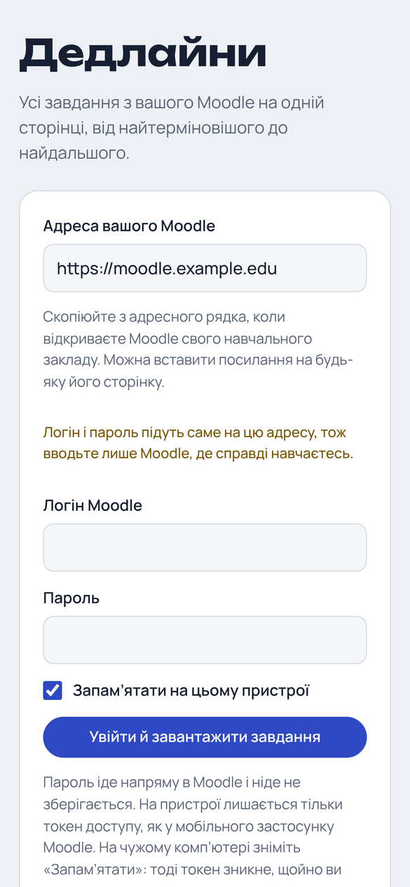
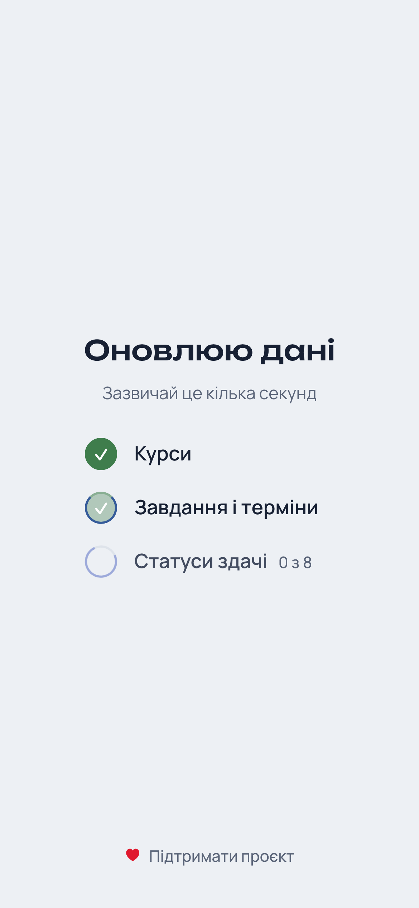
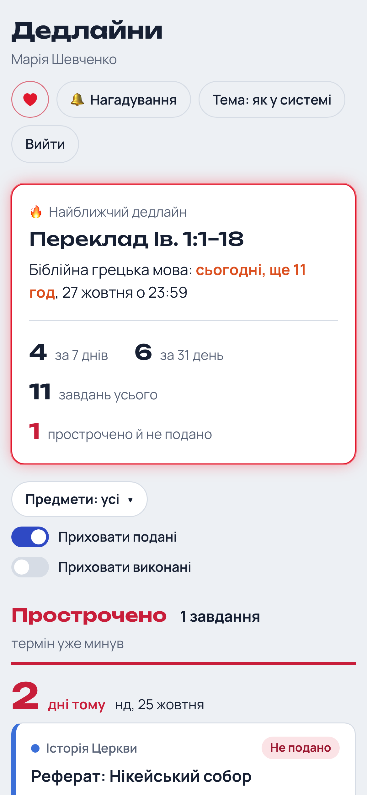
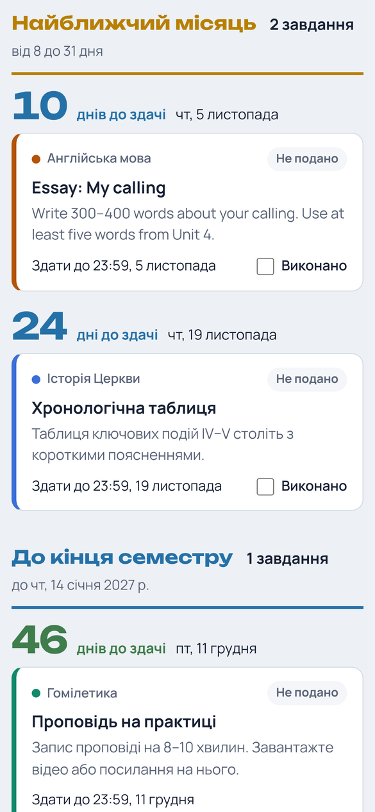
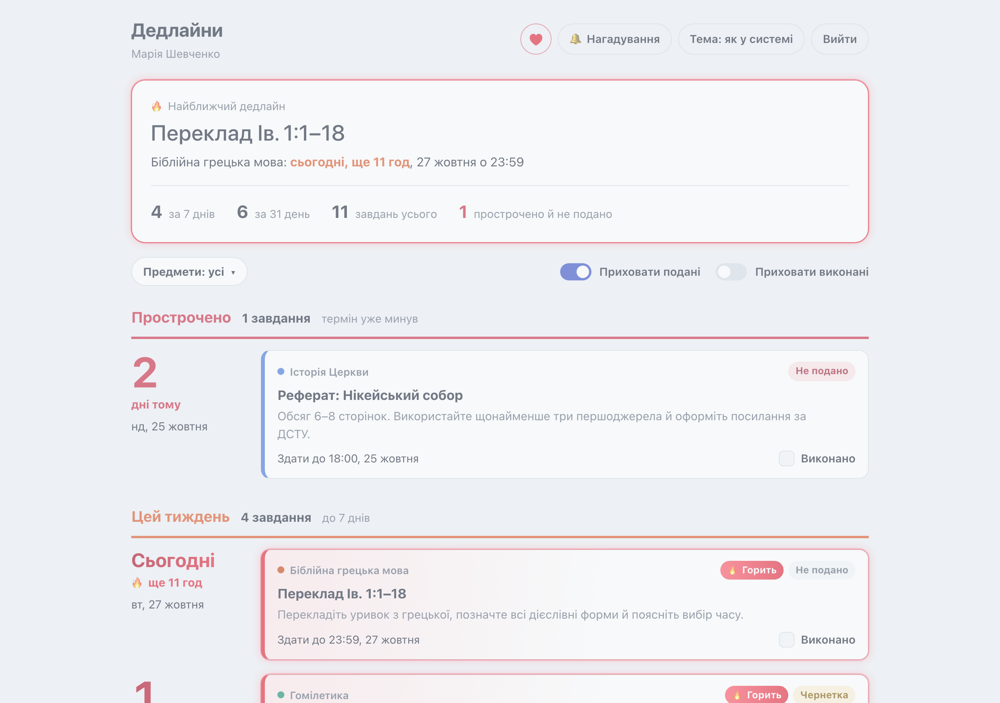
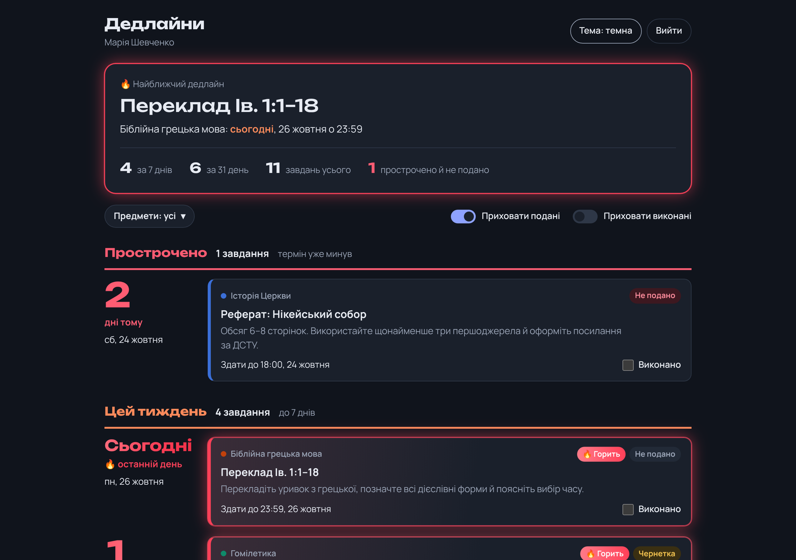
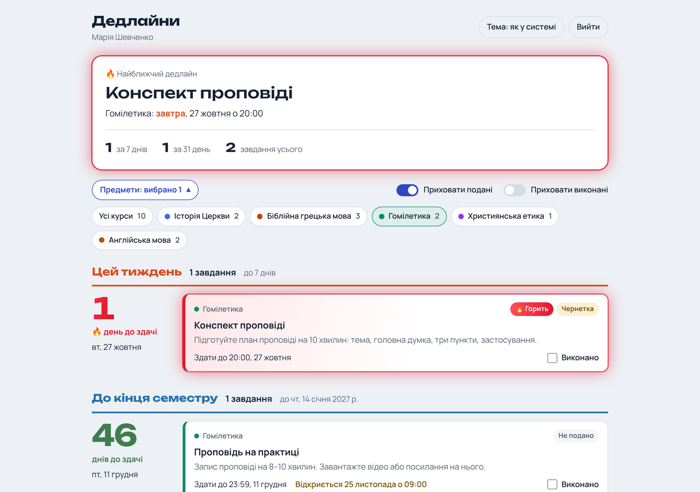
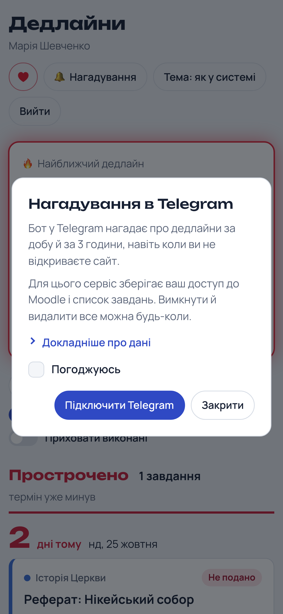
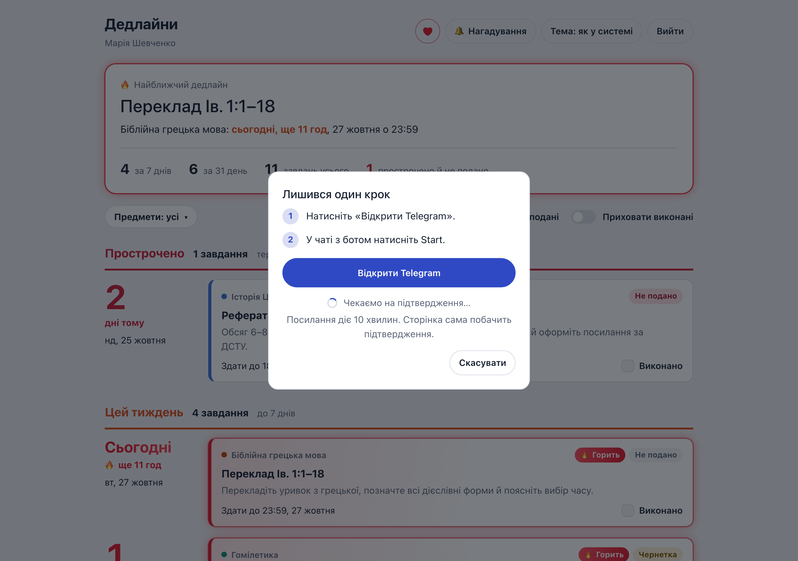

# Moodle Deadlines

**Дедлайни для Moodle** — every assignment from every current course on one page, sorted from the most
urgent to the furthest away. Sign in with your Moodle account and see at a glance what is overdue,
what is due this week and what is burning right now.

**Live: [moodle-dedlainy.tinyapp.workers.dev](https://moodle-dedlainy.tinyapp.workers.dev)**

Works with any Moodle that allows the official Moodle mobile app. No sign-up, nothing changes in
Moodle, and by default no backend: the site talks to your Moodle straight from the browser. Optional
[Telegram reminders](#telegram-reminders-optional) add a small server, only if you turn them on.

<p align="center">
  
  
  
  
</p>

## Features

- **One timeline for all courses.** Assignments, forums with due dates and quizzes, grouped into bands:
  *Overdue → This week → Next month → Until the end of term → Later → No due date*.
- **Days left, at a glance.** A big counter next to every date with correct Ukrainian plural forms
  (1 день · 2 дні · 5 днів) and an urgency colour. It recalculates itself at midnight.
- **What's burning.** Anything due today, tomorrow or the day after that you haven't submitted yet glows red.
- **Summary on top.** The nearest deadline plus how many tasks are due within 7 and 31 days, and how many are overdue.
- **Real submission status** from Moodle: not submitted, draft, submitted, graded (with the grade).
  Submitted work is hidden by default.
- **Your own checklist.** Tick "Виконано" on anything — it is remembered in the browser — and hide finished items.
- **Course filter** with a colour per course, collapsed into a single button so it doesn't take up the screen.
- **"Opens on…"** for assignments that haven't started accepting work yet, and the final cut-off date when there is one.
- **Always fresh.** Cached data shows instantly, fresh data is pulled from Moodle every time the page opens.
- **Light and dark themes**, built mobile-first, installable to the home screen.
- **Any Moodle.** Paste the address of any page of your Moodle; a link like `?site=moodle.uni.edu` pre-fills it.
- **Telegram reminders** (optional): a bot messages you 24 h and 3 h before an unsubmitted deadline, even when you do not open the site.

<p align="center">
  
  
</p>
<p align="center">
  
</p>

## How it works

```
Browser ──► /login/token.php        login + password → token (same as the Moodle mobile app)
        ──► /webservice/rest/server.php
              core_webservice_get_site_info
              core_course_get_enrolled_courses_by_timeline_classification   (in-progress courses only)
              mod_assign_get_assignments · mod_forum_get_forums_by_courses
              core_calendar_get_action_events_by_courses                      (quizzes and other activities)
              mod_assign_get_submission_status                                (one per assignment, 4 at a time)
        ──► builds the timeline locally and caches it in the browser
```

By default the site is fully static. All requests go straight from the student's browser to their Moodle — there is no
server in between that could see a password or a token. Only if a student turns on Telegram reminders does a Worker
store their token (see below).

## Privacy & security

- **The password is never stored.** It is used once to get a token and then cleared from the form.
- **Only the token is kept**, in `localStorage`, or only until the tab is closed if "Remember me" is off.
  Logging out removes it (after a confirmation); a token can be fully revoked in Moodle under
  *Preferences → Security keys*.
- **Read-only.** Only `*_get_*` Web Service functions are called — nothing is submitted or changed.
- **HTTPS only** for the Moodle address, so credentials never travel in plain text.
- **Untrusted content stays inert.** Descriptions from Moodle are converted to plain text (scripts are dropped)
  and links are allowed only if they are `http(s)`.
- **Anonymous first-party statistics.** The site counts visits, logins, opening the reminders dialog and donate clicks through the
  Worker (`/api/hit`): a day, an hour, a hash of a random browser id and the event name. No IP, no user agent, no third-party
  scripts, no cookies; Do Not Track / Global Privacy Control and a switch on the privacy page turn it off. Kept 13 months.
  The owner reads it on a key-protected page (`/stats` on the Worker).
- **Abuse limits** inside the Worker: 60 link attempts and 1200 statistics events per client address per hour. The counter is
  keyed by a secret-keyed hash that changes every hour (the address is never stored) and rows are deleted after two hours.
- **Strict headers** via `public/_headers`: a tight Content-Security-Policy, no framing, no referrer.

The plain-language privacy notice shown to students is [`public/privacy.html`](public/privacy.html).

## Telegram reminders (optional)

A student can link the site to a Telegram bot ([`worker/`](worker/), a Cloudflare Worker with a D1 database):

- The site sends the Moodle token to the Worker, which stores it **encrypted** (AES-256-GCM, key kept as a Worker
  secret, user id bound as AAD). Only a hash of the browser's sync key is stored; it authenticates the site API.
- Every minute a cron job sends the reminders that are due (24 h and 3 h before a deadline, quiet hours 23:00-08:00,
  "Already done" and "Later" buttons) and refreshes one user's tasks from Moodle (every 3 hours per user), so tasks
  added later are covered even if the student never opens the site again.
- The Moodle address is validated before every fetch (https only, public domain names, no redirects, size and time
  limits). An expired token pauses the user and notifies them once.
- Everything is deletable: the button on the site, `/stop` in the bot, logging out, and automatic cleanup (tasks 7 days
  after a deadline, abandoned link attempts after 10 minutes, and users who have not visited the site for 60 days, who are
  warned in the bot 7 days before and told when it happens).

<p align="center">
  
  
</p>

Design notes and stages: [`docs/plans/telegram-reminders.md`](docs/plans/telegram-reminders.md). Deployment:
[`docs/deployment.md`](docs/deployment.md).

## Tech stack

| Area | Tools |
|---|---|
| UI | React 19, TypeScript (strict) |
| Build | Vite |
| Styling | Plain CSS with custom properties, light/dark tokens, `prefers-reduced-motion` |
| Data | Moodle Web Services REST API |
| Tests | Vitest (logic, API client with mocked `fetch`), Playwright against a mocked Moodle |
| Hosting | Cloudflare Workers static assets (any static host works) |

## Getting started

Requirements: Node.js 20.19+.

```bash
npm install
npm run dev        # http://localhost:5173
npm test           # unit tests
npm run build      # production build in dist/
```

To preview the "burning" effect on more tasks, open the site with `?burnDays=7`.

## Deploying

The build is a plain static folder, so it can go anywhere. For Cloudflare (config in `wrangler.jsonc`):

```bash
npx wrangler login   # once
npm run deploy       # build + publish to <name>.<your-subdomain>.workers.dev
```

## Testing

- `npm test` — unit tests for dates and Ukrainian plurals, address handling, timeline grouping and the
  "burning" rule, the Moodle client, the reminders sync, anonymous statistics, and the whole Worker (token
  encryption, reminder planning, the site API, the bot, delivery, refresh, cleanup).
- `e2e/mock-moodle.py` — opens the built site in Chromium against a fake Moodle and a mocked reminders Worker, and
  walks through sign-in, the loader, bands, filters, the checklist, the reminders dialog, the donate link,
  statistics events, themes, logout, an expired token and the phone layout (42 checks). It also regenerates the
  screenshots above. Nothing in it talks to the real Worker.

```bash
pip install playwright && playwright install chromium
TZ=Europe/Kyiv python e2e/mock-moodle.py dist docs/screenshots
```

## Project structure

```
src/
  App.tsx            session, data refresh, screens
  components/        sign-in, summary, filters, bands, task card, logout dialog
  hooks/             persisted state, midnight tick
  lib/
    moodle.ts        Web Services client and data collection
    board.ts         bands, urgency, "burning", summary — pure functions
    dates.ts         Ukrainian dates and plural forms
    url.ts           Moodle address normalisation and safe links
    storage.ts       localStorage / sessionStorage that never throws
  config.ts          tunable constants (burn threshold, colours, storage keys)
public/              icons, web manifest, security headers
e2e/                 Playwright check against a mocked Moodle
tools/               the very first version: a console script that dumps Moodle data to JSON
```

## How it was built

Designed and developed by me, with [Claude Code](https://claude.com/claude-code) as an AI pair-programmer.
It started as a single HTML file for my own seminary's Moodle and grew into a small React app that works
for any Moodle.
